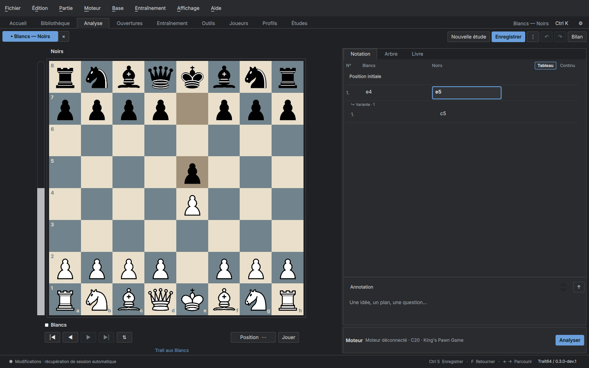
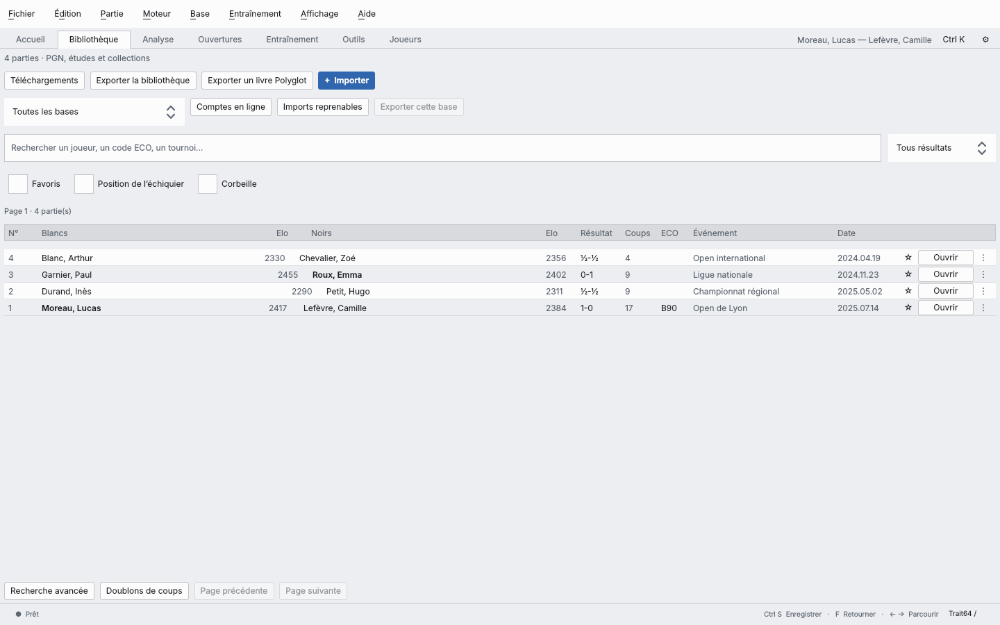

<div align="center">

# Trait64

**Free chess software for Linux: game databases, Stockfish analysis, opening preparation and training. No account, no cloud, no ads.**

[](https://github.com/SimzyGit/Trait64/releases)
[](LICENSE)

[](https://github.com/SimzyGit/Trait64/actions/workflows/linux.yml)

**English** · [Français](README.md)

</div>



## Download

**Linux (Debian, Ubuntu, Mint, Fedora…)**: one command in a terminal.

```bash
curl -fsSL https://raw.githubusercontent.com/SimzyGit/Trait64/main/install.sh | bash
```

It downloads the latest release, checks its SHA-256 checksum and adds **Trait64** to your applications menu, with no password and no compiling. Later updates happen inside the app (**Help → Updates**). To uninstall, append `-s -- --uninstall` to the same command.

Or pick a file from the [releases page](https://github.com/SimzyGit/Trait64/releases):

| System | File | Install |
| --- | --- | --- |
| Debian 12 | `trait64_…_debian12_amd64.deb` | double-click, or `sudo apt install ./file.deb` |
| Debian 13 | `trait64_…_debian13_amd64.deb` | double-click, or `sudo apt install ./file.deb` |
| Other 64-bit Linux | `Trait64-…-linux-x86_64.AppImage` | make it executable, then run it |

Windows and macOS builds are not published yet; the code already compiles on both in CI. No engine is bundled: install Stockfish from your distribution (`sudo apt install stockfish`) or download Stockfish, Arasan or PlentyChess from **Library → Downloads**.

## Features

- **Game library**: fast PGN import (hundreds of thousands of games), search by player, opening, rating, date, exact position or pawn structure, player profiles.
- **Your Lichess and Chess.com games**: save your accounts; each sync only fetches new games.
- **Analysis**: Stockfish or any UCI engine, multiple lines, side-by-side engines, full game review (forward pass, then backward pass) with an evaluation graph, explained mistakes and tactical motifs.
- **Openings**: statistical tree from your own games, Polyglot books (read and write), repertoires with transpositions, novelty finder, opponent preparation dossier.
- **Training**: rated puzzles (the free Lichess set and your own blunders), spaced-repetition cards, repertoire review.
- **Play**: against an engine at a chosen rating, two players with a clock, engine tournaments.
- **Your data stays yours**: local SQLite, automatic backups, PGN and FEN in and out.



The interface follows your system language, French or English (change it in **View → Pieces, board and colours**). Trait64 is in **alpha** and moving fast: see the [changelog](docs/CHANGELOG.md) and the [roadmap](docs/ROADMAP.md) (in French).

## Build from source

```bash
sudo apt install build-essential cmake ninja-build libarchive-dev libsqlite3-dev qt6-base-dev qt6-declarative-dev
cmake -S . -B build -G Ninja -DCMAKE_BUILD_TYPE=Release
cmake --build build
ctest --test-dir build --output-on-failure
./build/trait64
```

The full list of runtime QML modules is in [scripts/install-from-source.sh](scripts/install-from-source.sh), which installs them, builds, runs the tests and installs Trait64 into `~/.local`.

## Contributing

Bug reports, ideas and pull requests are welcome, in English or French: see [CONTRIBUTING.md](CONTRIBUTING.md). Report security issues privately ([SECURITY.md](SECURITY.md)).

## License

Trait64 is licensed under the **GNU AGPL v3 or later** ([LICENSE](LICENSE), [third-party notices](THIRD_PARTY_NOTICES.md)). The name and logo are covered separately ([TRADEMARKS.md](TRADEMARKS.md)). UCI engines and downloadable game collections are separate programs and data from their own sources.
