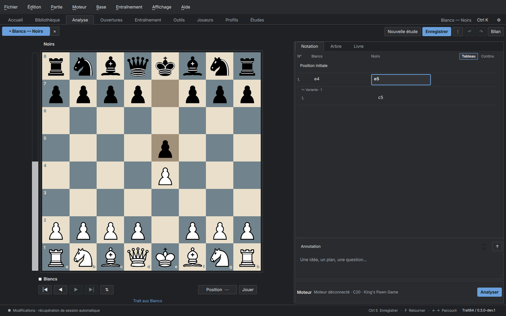
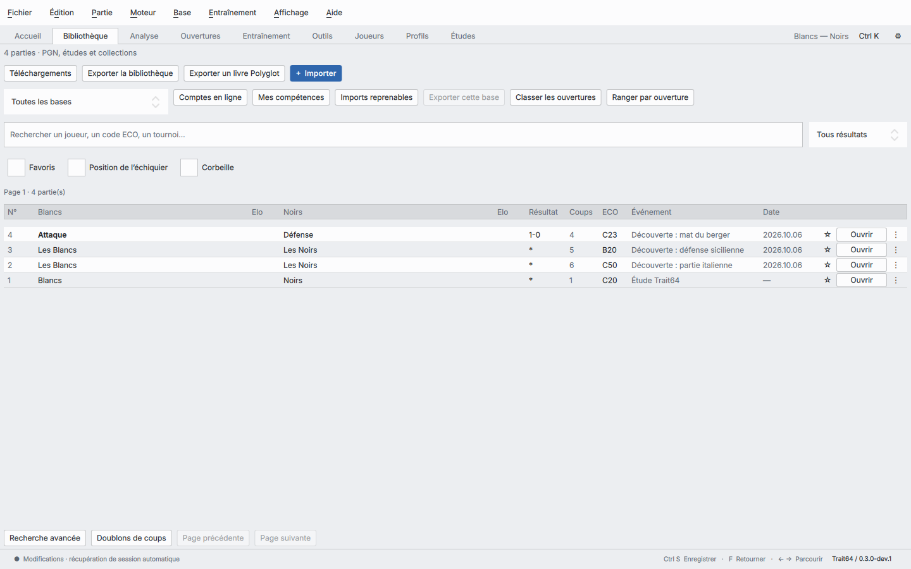

<div align="center">


# Trait64

**Votre base de parties, votre analyse, votre progression — sur votre machine.**
Un logiciel d’échecs libre, dans l’esprit de ChessBase et SCID : bases de parties, analyse Stockfish, préparation d’ouvertures et entraînement. Sans compte, sans cloud, sans publicité.

[](https://github.com/SimzyGit/Trait64/releases)
[](LICENSE)

[](https://github.com/SimzyGit/Trait64/actions/workflows/linux.yml)

[English](README.en.md) · **Français**

</div>



## Télécharger

**Linux** — une seule commande, aucune compilation, aucun mot de passe :

```bash
curl -fsSL https://raw.githubusercontent.com/SimzyGit/Trait64/main/install.sh | bash
```

Elle prend la dernière version, vérifie son empreinte SHA-256 et ajoute Trait64 au menu des applications. Les mises à jour se font ensuite depuis le logiciel (**Aide → Mises à jour**). Pour désinstaller : la même commande suivie de `-s -- --uninstall`.

Ou bien, depuis la [page des versions](https://github.com/SimzyGit/Trait64/releases) :

| Votre système | Fichier | Installation |
| --- | --- | --- |
| Windows 10 ou 11 (64 bits) | `Trait64-…-windows-x86_64.zip` | décompressez, lancez `trait64.exe` |
| macOS (puce Apple) | `Trait64-…-macos-arm64.dmg` | ouvrez l’image, glissez dans Applications |
| Debian 12 · 13 | `trait64_…_debianXX_amd64.deb` | `sudo apt install ./fichier.deb` |
| Autre Linux 64 bits | `Trait64-…-linux-x86_64.AppImage` | rendez exécutable, puis ouvrez |

Le paquet Debian s'installe depuis un terminal : le double-clic ne mène nulle part, Debian n'installant plus d'installateur graphique de `.deb` par défaut.

Les paquets ne sont pas signés : au premier lancement, Windows (SmartScreen) et macOS (Gatekeeper) demandent une confirmation. Sur macOS, faites clic droit → **Ouvrir**.

**Un moteur, ensuite.** Aucun n’est imposé ni incorporé. Installez Stockfish depuis votre distribution (`sudo apt install stockfish`), ou prenez Stockfish, Arasan ou PlentyChess dans **Bibliothèque → Téléchargements**.

## Pourquoi Trait64

**Vos données restent vos données.** Une base SQLite dans votre dossier personnel, des sauvegardes automatiques, du PGN et du FEN en entrée comme en sortie. Pas de compte à créer, rien qui parte sur un serveur, aucune télémétrie. Le jour où Trait64 ne vous convient plus, vos parties sont toujours lisibles ailleurs.

**Une vraie base, pas une liste.** L’import PGN avale des centaines de milliers de parties et reprend où il s’était arrêté si vous l’interrompez. Vous cherchez ensuite par joueur, ouverture, Elo, date, résultat, position exacte ou structure de pions.

**L’analyse de Stockfish, expliquée.** Le bilan d’une partie passe le moteur dans un sens puis dans l’autre, puis vous donne un pourcentage de précision — pour la partie entière, et séparément pour l’ouverture, le milieu de jeu et la finale. Chaque faute est située, classée et expliquée.

**Ce que personne d’autre ne peut vous dire.** Votre répertoire et vos parties sont au même endroit, sur votre machine : Trait64 croise les deux et vous montre à quel coup vous quittez votre propre préparation, dans quelle proportion, et avec quel résultat.

**Vos progrès, mesurés sur vos parties.** Reliez vos comptes Lichess et Chess.com à un profil, lancez un bilan sur vos dernières parties, et le tableau de bord vous dit où vous en êtes : précision par phase, gaffes pour cent coups, réussite tactique, et l’évolution mois par mois. La comparaison se fait avec vous-même, pas avec une moyenne inventée.

## Ce que fait Trait64

- **Bibliothèque** — import PGN reprenable, recherche multicritère, fiches joueurs, collections, corbeille, sauvegardes automatiques.
- **Comptes en ligne** — Lichess et Chess.com, sans mot de passe ; chaque synchronisation ne récupère que les parties nouvelles.
- **Profils de joueur** — un seul profil rassemble vos comptes et votre fiche FIDE, dont les classements se lisent dans les listes officielles de la fédération.
- **Analyse** — Stockfish ou tout moteur UCI, plusieurs variantes, comparaison de moteurs côte à côte, file d’analyse en arrière-plan reprenable.
- **Bilan de partie** — graphe d’évaluation, précision par phase, gaffes et imprécisions expliquées, motifs tactiques reconnus, annotation du PGN, et un point coloré par coup dans le carnet : vert pour un bon coup, rouge pour une gaffe, violet quand un mat entre dans le compte.
- **Bilan de toute une base** — après une synchronisation ou un import, un bouton passe en revue le lot entier à la profondeur de votre choix, sans refaire ce qui a déjà été vu.
- **Tableau de bord** — précision, fautes pour cent coups, tactique, progression mois par mois.
- **Ouvertures** — arbre statistique de votre base, classement ECO automatique des parties qui n’en portent pas, dossier d’une position (coups joués, score, découpage par force des joueurs, parties modèles), livres Polyglot, répertoires avec transpositions, détection des nouveautés, dossier de préparation contre un adversaire donné.
- **Répertoires** — import d’un dossier entier venu d’En Croissant ou de Pawn Appétit, PGN compressés compris, et une comparaison avec vos propres parties : à quel coup vous quittez votre préparation, et ce qui était prévu à la place.
- **Entraînement** — puzzles notés (base Lichess libre et vos propres gaffes), cartes à répétition espacée, révision de répertoire.
- **Jeu** — contre le moteur à un Elo choisi, à deux avec pendule, tournois entre moteurs.
- **Confort** — thème clair ou sombre, taille d’interface réglable, français et anglais, **Ctrl K** pour la palette de commandes.



Trait64 est en **alpha** et évolue vite : voir les [nouveautés](docs/CHANGELOG.md), l’[état du projet](docs/PROJECT-STATUS.md) et la [feuille de route](docs/ROADMAP.md).

## Premiers pas

1. Sur l’accueil, cliquez **Exemples**, puis ouvrez une partie dans la **Bibliothèque**.
2. Parcourez les coups avec ← et →. Jouez un autre coup pour créer une variante.
3. Installez un moteur (**Bibliothèque → Téléchargements → Moteurs**), puis **Analyser** pour la position, ou **Bilan** pour toute la partie.
4. Ajoutez vos comptes avec **Fichier → Comptes Lichess et Chess.com**, synchronisez, puis lancez le bilan du lot importé.
5. Ouvrez **Fichier → Bilan de vos compétences** pour voir où vous en êtes.

## Documentation

| | |
| --- | --- |
| [Fonctions en détail](docs/FEATURES.md) | tout ce que fait Trait64, raccourcis, données et limites |
| [Installer et compiler](docs/BUILDING.md) | paquets, AppImage, compilation depuis les sources |
| [Comparaison](docs/COMPARISON.md) | Trait64 face à ChessBase, Scid vs. PC et En Croissant |
| [Moteurs et bases](docs/ENGINES-DATABASES.md) · [Mises à jour](docs/UPDATES.md) | catalogue vérifié et canaux de mise à jour |
| [Architecture](docs/ARCHITECTURE.md) · [Tests](docs/TESTING.md) | pour contribuer au code |

## Contribuer

Les signalements de bugs, les idées et les contributions sont bienvenus : lisez [CONTRIBUTING.md](CONTRIBUTING.md), puis ouvrez une [demande](https://github.com/SimzyGit/Trait64/issues/new/choose). Une faille de sécurité se signale en privé ([SECURITY.md](SECURITY.md)).

## Licence et composants

Code Trait64 : **GNU AGPL v3 ou ultérieure** — [LICENSE](LICENSE), [THIRD_PARTY_NOTICES.md](THIRD_PARTY_NOTICES.md). Le nom et l’identité visuelle restent distincts de la licence du code ; voir [TRADEMARKS.md](TRADEMARKS.md).

Trait64 réutilise `chess-library` sous MIT, et lie Qt dynamiquement depuis les paquets système. Les moteurs UCI restent des programmes séparés : le catalogue télécharge des versions vérifiées de Stockfish, Arasan et PlentyChess, mais aucun moteur n’est incorporé au binaire. Les collections PGN proviennent également de leurs sources d’origine. Aucun compte, publicité, télémétrie ou service distant n’est nécessaire à l’usage local. Un moteur que vous choisissez s’exécute avec vos droits : ne lancez que des exécutables de confiance.
