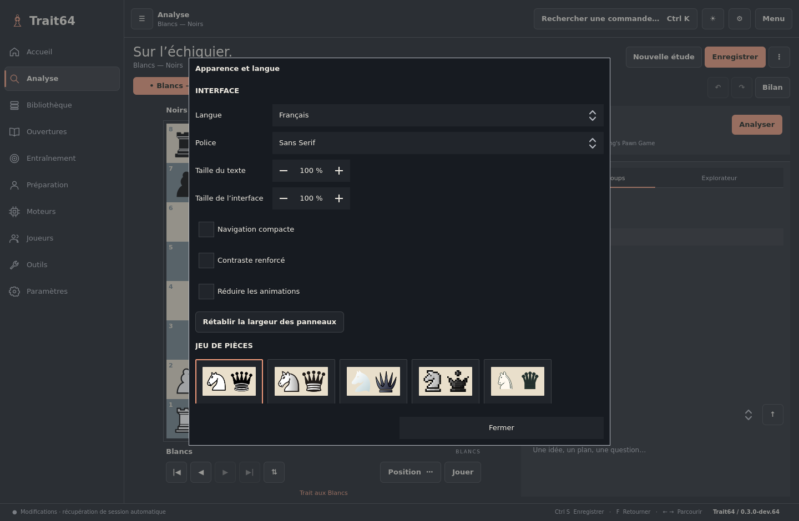

# Fonctions en détail

## Par domaine

- **Apparence** : cinq styles de pièces (Classique, Merida, Spatial, Pixel, Unicode), import de vos douze SVG, neuf palettes d’échiquier, couleurs personnelles des cases et du fond, thème clair/sombre, police et tailles, contraste renforcé, libellés français/anglais, notation figurine, coordonnées et repères réglables. Tous les choix sont mémorisés.
- **Échiquier** : clic/glisser, coups légaux, promotion au choix, échecs classiques et Chess960 (960 positions numérotées), éditeur graphique de position, inversion, flèches et cercles persistants dans le PGN.
- **Études** : arbre de variantes, promotion/suppression de branches, commentaires, NAG, métadonnées, annuler/rétablir, jusqu’à 16 onglets récupérés au redémarrage, duplication et fusion de deux études de même racine.
- **Explorateur d’études** : le dossier du disque où vivent vos PGN, parcouru sur place — sous-dossiers, taille des fichiers, marque de ceux qui sont déjà lus et de leur nombre de parties. Un clic lit un fichier neuf et ouvre le recueil des suivants, sans doubler les parties ; les formats des autres logiciels sont montrés et nommés plutôt que tus. Création de dossiers et enregistrement de l’étude ouverte au format PGN sur place : les fichiers restent la référence, lisibles par n’importe quel logiciel.
- **Fichiers** : PGN multijeux avec variantes, FEN, import/export EPD classique, conteneur T64 expérimental, diagramme PNG ou SVG avec votre apparence et annotations, étude PDF avec diagramme et notation. L’import PGN depuis un fichier travaille partie par partie, en arrière-plan, avec progression et annulation transactionnelle. Un gestionnaire séparé permet les imports PGN reprenables par lots, avec 1 à 8 lecteurs parallèles. L’export PGN de bibliothèque écrit aussi partie par partie. Comptes Lichess et Chess.com synchronisés (seules les nouvelles parties sont téléchargées) et glisser-déposer de fichiers dans la fenêtre.
- **Bibliothèque** : SQLite schéma 8, bases nommées et historique, recherche de fragments indexée FTS5 (si disponible), statistiques et arbres d’ouvertures actualisés à chaque écriture, filtres exacts indexés, recherche par joueur/événement/ECO/date/Elo/collection/résultat, matériel et positions incluant les variantes ; favoris, corbeille restaurable, recherche annulable en arrière-plan et pages par curseur, détection des doublons de ligne principale, réindexation annulable. Fiches joueurs, scores et ouvertures issues de votre base.
- **Moteurs et bases à télécharger** : trois moteurs vérifiés (Stockfish, Arasan, PlentyChess) et 42 collections PGN, dont les champions classiques, des championnes, matchs historiques et ouvertures. Paramètres UCI indépendants par profil ; filtres combinés par base et ouverture. [Mode d’emploi](ENGINES-DATABASES.md).
- **Analyse** : moteur UCI local, comparaison simultanée de 2 à 4 profils avec budgets CPU/hash partagés, MultiPV, insertion d’une ligne, profils de réglages, limite de profondeur, chemin Syzygy transmis aux moteurs compatibles. Bilan immédiat de la ligne principale avec graphe, pertes en centipions, annotations et création de cartes depuis les erreurs. Explications du bilan à partir de suites légales : réponse au coup joué ou proposition antérieure, captures/promotions/échecs/mats/pats et compte matériel ; motifs vérifiables (attaques multiples, clouages/enfilades du roi, échecs à la découverte et doubles échecs), ouverture d’une copie annotée avec repères PGN. File d’analyses persistante des lignes principales ou de toutes les variantes, copies indépendantes, pause/reprise, cache lié au moteur et à l’historique, export annoté ; scores de mat distincts des centipions et WDL lorsqu’il est fourni par le moteur.
- **Jeu local** : contre un moteur ou à deux sur le même ordinateur, camp/force/réflexion réglables, force limitée en Elo pour les moteurs compatibles, tournois toutes rondes entre 2 et 8 profils moteur avec classement, pendule avec incrément, abandon et réclamation de nulle.
- **Ouvertures** : explorateur des lignes principales de vos parties, résultats statistiques, livres Polyglot `.bin`, reconnaissance ECO hors ligne à partir de 3 865 positions nommées et attribution des balises à l’étude. Répertoires personnels par position et transposition, notes/priorités/alternatives, parties modèles, création/fusion/import/export PGN annulables en arrière-plan, lacunes observées dans la bibliothèque calculées sans bloquer l’interface, analyse moteur de toutes les variantes depuis une copie. Les transpositions sont développées une seule fois. Préparation par source, adversaire/couleur, période et Elo connu avec export CSV.
- **Entraînement** : puzzles tactiques notés (import de la base Lichess CC0 et puzzles tirés de vos erreurs, classement Elo, thèmes, indices), cartes depuis vos lignes ou les erreurs analysées, réponses adverses automatiques, solution, suivi quotidien/hebdomadaire, objectif et répétition espacée simple ; révision des positions de répertoire avec plusieurs réponses acceptées, calendrier et suivi des rappels manqués.
- **Mises à jour** : vérification GitHub en arrière-plan, Stable/Bêta/Développement, notes de version, téléchargement vérifié SHA-256, installation après sauvegarde et redémarrage.
- **Fiabilité** : sauvegardes automatiques toutes les 6 heures (14 instantanés), session atomique, sauvegarde SQLite complète, contrôle d’intégrité, sauvegarde avant migration du schéma, import classique annulé intégralement en cas d’erreur, import reprenable conservant les lots validés, protection de la bibliothèque contre un export sur elle-même.

## Premiers pas

Depuis l’accueil, cliquez **Exemples**, puis ouvrez une partie dans la bibliothèque. Parcourez les coups avec les flèches. Revenez en arrière et jouez un autre coup pour créer une variante.

Dans **Bibliothèque → Téléchargements → Moteurs**, vous pouvez installer un moteur vérifié, ou sélectionner un moteur UCI déjà présent sur le système depuis **Affichage → Paramètres**. Stockfish installé par Debian est souvent détecté dans `/usr/games/stockfish`. Chargez ou créez ensuite un profil, cliquez **Démarrer / appliquer**, puis **Analyser** dans l’onglet Analyse. L’analyse utilise toute la force du moteur ; la limitation de force concerne le jeu.

**Affichage → Pièces, échiquier et couleurs** personnalise l’échiquier, le fond, la police, les tailles et la langue de l’interface. Dans l’onglet Analyse, **Bilan** analyse la ligne principale ; les seuils de classement sont des repères simples, pas une mesure certifiée du niveau de jeu. Les fichiers Syzygy sont à fournir séparément.

Pour mémoriser une ligne, placez-vous **avant** son premier coup, puis **Créer une carte depuis ici**. L’entraînement reprend au maximum 40 demi-coups de la continuation principale. Il vérifie la ligne choisie, et non toutes les solutions équivalentes d’un problème tactique.

| Raccourci | Action |
|---|---|
| Ctrl N | Nouvelle étude (l’ancienne étude modifiée est conservée) |
| Ctrl O | Importer |
| Ctrl S | Enregistrer dans la bibliothèque |
| Ctrl K | Commandes rapides |
| ← / → | Position précédente / suivante |
| Début / Fin | Début / fin de la ligne |
| F | Retourner l’échiquier |
| Ctrl Z / Ctrl Maj Z | Annuler / rétablir une modification |
| Clic droit glissé | Ajouter/enlever une flèche persistante |
| Clic droit sur une case | Ajouter/enlever un cercle persistant |
| Maj / Ctrl / Alt + clic droit | Annotation rouge / bleue / jaune |

## Données et formats

Par défaut sur Linux : `~/.local/share/Trait64/Trait64/` (ou le dossier XDG équivalent). Le chemin effectif est affiché dans **Paramètres**. La bibliothèque est `library.sqlite` ; `session.json` contient les onglets et leurs positions actives. Les migrations créent d’abord une copie `.before-v2-….sqlite` ou `.before-v3-….sqlite` jusqu’à `.before-v8-….sqlite` à côté de la base. La migration 8 convertit les positions en clés entières puis compacte le fichier (`VACUUM`) : prévoir temporairement le double de la taille de la base en espace libre. Le schéma 3 construit ses index lors de la première ouverture : cela peut prendre du temps sur un grand corpus. Une ancienne version du logiciel ne doit pas ouvrir une base déjà migrée. Les paramètres sont enregistrés dans le dossier de configuration Qt de l’utilisateur.

Utilisez **Outils → Sauvegarder** pour une copie cohérente de la bibliothèque, entraînements inclus. **Ouvrir une base** ouvre une sauvegarde séparément sans écraser la base principale. Au lancement suivant, la base principale redevient active ; une étude venant d’une autre base conserve son contenu dans la session sans réutiliser son identifiant dans la mauvaise base.

PGN est le format d’échange recommandé. Le conteneur `.t64` livré est le **profil expérimental 0.1**, avec instantanés PGN, alignement, empreintes SHA-256 et deux points de récupération. Il ne prétend **pas** implémenter déjà le futur format compact Move16/TLV/BLAKE3 décrit dans la conception : voir [docs/format/T64-0.1.md](format/T64-0.1.md). Un export `.t64` existant ajoute une génération ; PGN exporte le contenu courant. Les exports PGN/T64 contiennent les parties, pas les favoris, collections ou entraînements : ceux-ci nécessitent la sauvegarde SQLite.

## Limites actuelles

Alpha : le [périmètre restant](ROADMAP.md) est explicite. Les tests automatiques couvrent les scénarios documentés dans [docs/TESTING.md](TESTING.md), sans garantir l’absence de tout bug.

Import PGN depuis un fichier : pas de plafond global de 64 Mio, mais **64 Mio par partie**, 100 000 nœuds par étude et 128 niveaux de variantes. Le collage PGN, l’EPD et le profil T64 restent limités à 64 Mio et 10 000 parties/positions. Résultats de bibliothèque paginés par 200 ; affichage de notation limité à 10 000 coups. Session limitée à 16 onglets et 64 Mio, historique annuler/rétablir à 64 étapes et 16 Mio par étude. L’import d’un répertoire est limité à 16 Mio et 200 parties ; l’édition des coups, le retrait de branches, le renommage, la suppression et les révisions restent synchrones. Les corpus de plusieurs millions de parties n’ont pas été qualifiés.

La recherche de positions inclut les variantes ; l’explorateur statistique utilise les lignes principales. Le bilan analyse la ligne principale, par défaut en deux passages (rapide du début à la fin, puis complet de la fin vers le début) : seuils fixes de 50/100/250 centipions pour imprécision/erreur/gaffe, dépendants du moteur et du budget choisi. La création de cartes depuis ce bilan concerne les échecs classiques et conserve une ligne de solution, sans reconnaître toutes les solutions équivalentes. Les résultats du bilan immédiat restent en mémoire ; **Annoter l’étude** enregistre les évaluations dans le PGN. La file d’analyses séparée conserve ses tâches et résultats en SQLite, peut analyser les variantes et reprendre après une interruption.

Pas encore : versions Windows et macOS, Flatpak, pendules à plusieurs périodes, formats SCID/ChessBase, couverture probabiliste et comparaison de répertoires, recherche par placement partiel de pièces, plugins et format T64 compact final. Le monogramme T64 reste provisoire.
