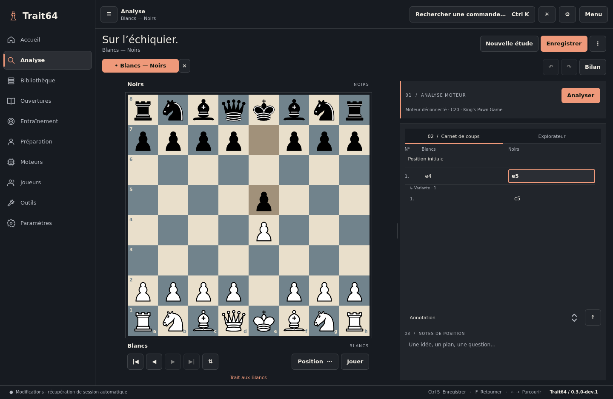
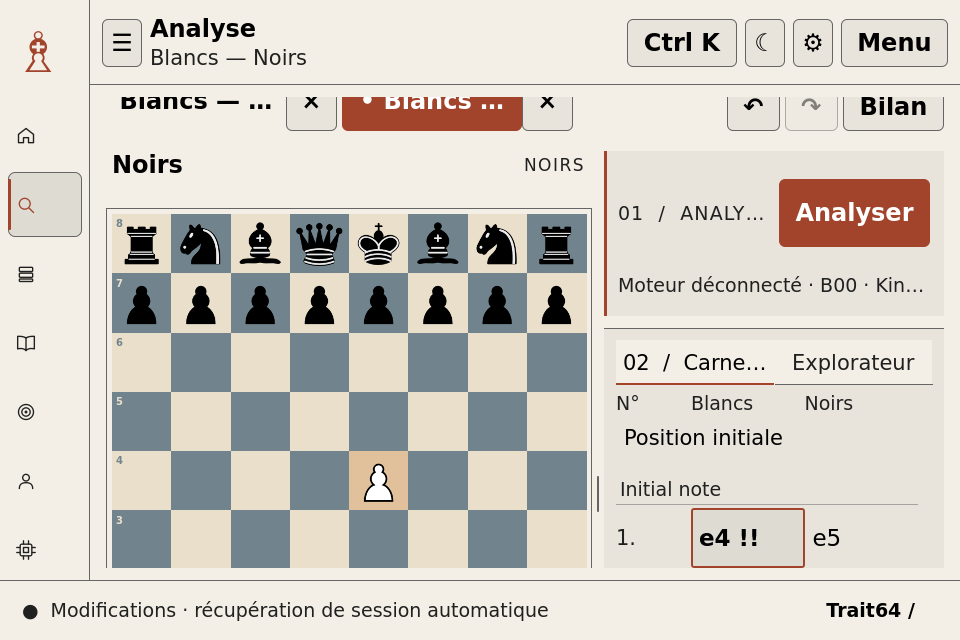

# Carnet de coups côte à côte

Lot validé localement, branche `ui/paired-move-notebook`, PR #14. Base : main
`5b41204047375d91f1e580756addd9879d59d7a4` / dev.64.

Le carnet de l'espace Analyse présente un numéro, le demi-coup blanc et le
demi-coup noir. Chaque cellule conserve son identifiant de nœud. Les paires
suivent exclusivement les relations parent/enfant de la même branche ; les
variantes sont des blocs distincts indentés. Les numéros et couleurs proviennent
de la position précédant le coup. Un départ FEN avec les Noirs garde une cellule
Blancs vide, et une fin après le coup blanc garde une cellule Noirs vide.

Les commentaires restent associés à leur demi-coup et occupent toute la largeur
avec retour à la ligne. La position initiale reste accessible. Les NAG restent
dans la cellule correspondante. La sélection utilise une bordure d'accent et une
police grasse. Le défilement suit la zone du coup, sans chercher à faire entrer
un commentaire long dans le viewport. Un rafraîchissement sans changement de
position ne doit pas ramener automatiquement le lecteur au coup courant.

La notation française traduit uniquement les initiales de pièces et promotions
à l'affichage. Les données internes, PGN et exports existants gardent le SAN
standard. `notation` reste disponible pour l'export PDF ; le nouveau modèle est
`moveRows`. Schéma SQLite 7 inchangé.

## Vérifications à effectuer

`ctest --test-dir build -R move_notebook --output-on-failure` : variantes
imbriquées, paires, numéros, FEN noir, NAG, commentaires, clics, navigation,
préférences, sauvegarde/réouverture et PGN standard. Définir
`T64_NOTEBOOK_SCREENSHOTS=/chemin/captures` pour capturer six configurations,
dont 960 × 640 à texte 150 % / interface 125 %, clair/sombre et contraste élevé.
Les autres suites restent requises, dont `desktop_layout` et
`desktop_interactions` avec Stockfish réel.

Le commit produit `2d5e8947ea45deb8ae80a76e4983f2b80bfbbd50` passe les **14 suites locales
sans suite ignorée en 157,24 s**, Stockfish 16 réel inclus. Le carnet passe
207 contrôles, captures comprises, dans six configurations, sans avertissement
QML. La matrice existante passe ses neuf configurations et 164 captures.
Les captures du carnet et de la matrice sont distinctes. Rapports :
[validation](VALIDATION.md),
[journal local](VALIDATION.md) et
[matrice](VALIDATION.md).

À 960 × 640 avec texte 150 % / interface 125 %, la page reste défilante : le
suivi du coup ajuste aussi ce défilement après le calcul de mise en page Qt.
Le test vérifie le rectangle réellement visible de la page et attend la fin du
suivi programmé, sans forcer lui-même la sélection. Un rafraîchissement de la
même position conserve le défilement manuel du carnet.

La CI [40742429259](https://github.com/feuvrierbernardinisimhon-png/Trait64/actions/runs/40742429259)
est encore en cours. Aucune nouvelle version n'est annoncée comme publiée.
Aucun benchmark 100k n'a été relancé pour ce lot.

L'ancien échec isolé « Latest preparation filters replace stale request » n'a
pas été reproduit : trois passages de la suite d'interactions sur ce commit
réussissent (39,69 s, 36,30 s et 28,63 s). Assertion et délais de ce test
inchangés ; aucune cause ni correction de ce défaut n'est revendiquée.

## Vérification manuelle sur Voyager / Wayland

1. Sauvegarder une étude puis ouvrir un PGN avec variantes et commentaires.
2. Dans Analyse, cliquer alternativement les colonnes Blancs et Noirs : vérifier
   la position et la bordure du coup courant sur chaque branche.
3. Parcourir avec Gauche/Droite et Début/Fin ; revenir à la position initiale.
4. Réduire à 960 × 640, augmenter texte à 150 % et interface à 125 % ; vérifier
   colonnes, commentaires, barre de défilement et accès aux actions.
5. Changer langue, thème et contraste sans enregistrer : vérifier que la position
   et les commentaires restent intacts.
6. Ajouter une variante, un commentaire et une annotation, enregistrer puis
   rouvrir ; comparer le PGN exporté.
7. Démarrer/arrêter Stockfish et changer de position, vérifier le focus clavier.
8. Tester le défilement au pavé tactile et à la molette sur le matériel réel.

Les captures hors écran ne valident ni le GPU, ni Wayland, ni le matériel cible.

## Captures

[Avant : dev.64](https://github.com/feuvrierbernardinisimhon-png/Trait64/blob/5b41204047375d91f1e580756addd9879d59d7a4/docs/screenshots/analysis.png)

